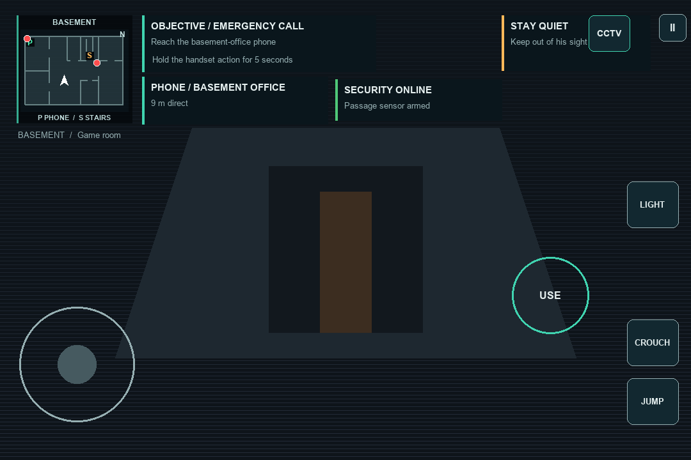
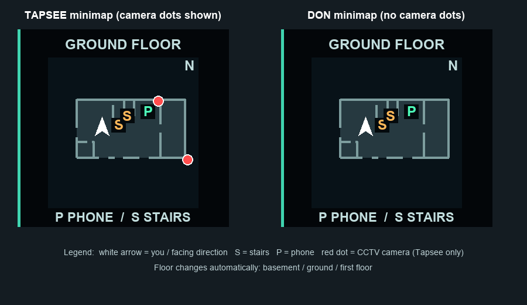

# GAME OVER

**A first-person survival-horror game for Android. One intruder, one survivor, one mansion, six minutes.**

Tapsee has to reach the phone and call the police. Don has to stop her. Play alone against an AI opponent, or play either role against a friend over local Wi-Fi.

  
  

> **Status:** playable prototype, not a finished release. It has not yet been tested in a real two-device match or profiled on target hardware.

# 📦 Download

| Version | Platform | Download |
|---|---|---|
| **v0.3.27** (latest) | Android 8.0+ (ARM64) | [**GAME-OVER-v0.3.27.apk**](https://github.com/YashSomwanshi80/Game-Over/releases/download/v0.3.27/GAME-OVER-v0.3.27.apk) |

SHA-256: `d33d2cf5529d12cf9610d9e2aa217fe4242f445dc8fe2d7ac6c643c169b7eec6` (70.9 MB, release build, ARM64). Built with Unity 6000.5.7f1 and **not yet tested on a physical phone**.

All versions: [Releases page](https://github.com/YashSomwanshi80/Game-Over/releases)

**To install:** download the APK on your phone, open it, and allow "Install unknown apps" for your browser or file manager when Android asks. Both players need the same version to play LAN multiplayer.

# 🎮 The Game

You play one of two roles in the same house during a storm:

- **Tapsee, the survivor.** Reach the telephone, hold the call for 5 seconds, then stay alive until the police arrive. Hide, crouch, use your flashlight, watch the CCTV and read your minimap.
- **Don, the intruder.** Break in, search the house and catch Tapsee before help arrives. Check hiding spots, cut the main power and jam her cameras.

A match lasts 6 minutes. If Tapsee never completes the call, Don wins when the time runs out.

# ✨ Features

┈➤ **The house** 
• Three floors (basement, ground, first floor) plus a garage, balconies and grounds 
• 21 doors, bedrooms, a library, a tech studio, a gym, a workshop, a laundry and a safe room 
• Floor plans with doors and camera positions: open [HOUSE-BLUEPRINT.html](HOUSE-BLUEPRINT.html) in a browser  

┈➤ **Stealth gameplay** 
• Crouch, sprint with stamina, jump 
• 13 hiding spots, including under beds, in cabinets and in the laundry trolley 
• Flashlight with limited battery, plus spare batteries in the workshop 
• Hand-cranked radio in the game room that makes noise to lure Don  

┈➤ **Security systems** 
• 7 CCTV cameras (living room, stairs, basement office, basement east hall, main gate, driveway, back garden) 
• Motion sensors with alarms, and a main breaker you can cut and restore 
• Don can jam the cameras for 15 seconds at a time  

┈➤ **Minimap** 
• Shows your floor, your heading, the stairs and the phone 
• Tapsee's minimap also marks the CCTV cameras. Don's does not  

┈➤ **Modes** 
• Solo against AI Don, with Easy, Normal and Hard settings 
• LAN multiplayer: host or join a room by code and play either role 
• Multiplayer opening: Don breaks in after 60 seconds, the house starts in a blackout, and the phone is in the basement office. The call becomes possible after 120 seconds  

┈➤ **Presentation** 
• Cinematic intro, storm weather, procedural sound design, surface-dependent footsteps, police siren and arrival lights 
• Touch controls: virtual joystick, look area, and large buttons for phones  

# 🆕 Latest Version: v0.3.27

- **New minimap layout.** The minimap is now at the top left, with the objective card beside it. The security and phone-distance cards were rearranged to fit.
- **Bigger, clearer map.** The house now fills the whole map box, and the panel is slightly see-through so it blocks less of the view.
- **Camera dots for Tapsee only.** Red dots show where each CCTV camera is on your current floor. Don never sees them.
- **CCTV camera moved.** CAM 04 moved from the game room to the basement east hall, where the storage, laundry and workshop doors meet.
- **Phone placement.** The phone is in the living room in solo and in the basement office in multiplayer. The minimap follows this.

## Earlier versions (summary)

- **0.3.2x:** capture and rescue rules brought in line across solo and multiplayer. Once the call is made, Tapsee only needs to survive the remaining match time, up to 100 seconds. Character select, late-call handling, and a basement-office phone for multiplayer.
- **0.3.1x:** 7-camera CCTV with previous/next selection in multiplayer, motion sensors with positional alarms, police siren audio, Tapsee victory audio, house audio and dial tone.
- **0.3.8 to 0.3.11:** basement stealth items (linen trolley hiding spot, hand-cranked radio, workshop battery drawer), character footstep audio, kitchen clearance changes.
- **0.3.5 to 0.3.6:** strict LAN message framing fix, room codes, and the multiplayer break-in and blackout opening.
- **0.3.x:** first-person movement and touch controls, hiding system, AI Don with fair hearing and search, solo difficulty settings, Android IL2CPP builds.

The full engineering log is in [RELEASE-PROGRESS.md](RELEASE-PROGRESS.md).

# 🛠 Tech

- Unity 6000.3.21f1, built-in render pipeline, Linear colour space
- C#, about 7,000 lines across 80+ scripts
- ARM64 IL2CPP Android builds, minimum API 26
- Most of the mansion is built from code-generated geometry, with some scanned furniture and rigged characters

# 🧑‍💻 Build From Source

1. Install Unity 6000.3.21f1 (with Android Build Support if you want an APK).
2. Open this folder as a Unity project.
3. Open `Assets/Scenes/Prototype.unity` and press Play.
4. For an Android build, run `GameOverAndroidBuild.Build` from `Assets/Editor` in batch mode with `-buildTarget Android`.

# ⚠️ Known Limitations

- Two-device LAN matches and real-phone performance (frame rate, memory, heat) are not yet measured.
- Phones can get warm in longer sessions. Optimisation is planned.
- Art is a mix of generated geometry and imported assets, so visual quality is uneven.
- Balance for matches between two people has not been playtested.

# 📚 Project Docs

- [RELEASE-PROGRESS.md](RELEASE-PROGRESS.md): what is done, verified and still open
- [PRODUCTION-ROADMAP.md](PRODUCTION-ROADMAP.md): acceptance phases
- Feature notes such as [ROOM-CODES.md](ROOM-CODES.md), [SOLO-DIFFICULTY.md](SOLO-DIFFICULTY.md) and [DON-DETECTION.md](DON-DETECTION.md)

# Credits

Third-party scanned assets and sounds keep their own licences. See [Assets/CharacterAssetCredits.md](Assets/CharacterAssetCredits.md) and [ESTATE-ASSET-CREDITS.json](ESTATE-ASSET-CREDITS.json).
